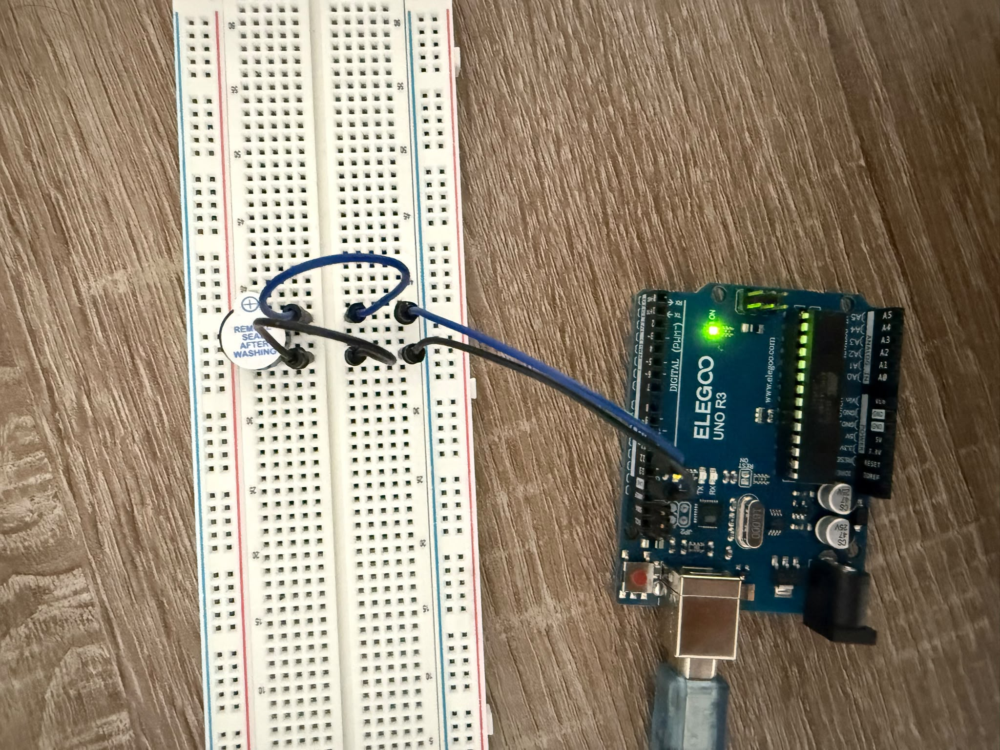

# 05 – Aktiver Summer

## Ziel
Mit einem aktiven Summer einen Ton erzeugen und den Unterschied zwischen
einem aktiven und einem passiven Summer kennenlernen.

## Bauteile
- ELEGOO UNO R3
- ein aktiver Summer
- ein Steckbrett
- 4 Jumper-Kabel

## Schaltung
Zuerst stecke ich den aktiven Summer in das Steckbrett. Der aktive Summer hat
zwei Beine: Das lange Bein ist der Pluspol, das kurze Bein ist der Minuspol.
Dann verbinde ich Pin 12 mit dem langen Bein des Summers. Jetzt braucht der
aktive Summer auch einen GND-Anschluss. Deshalb verbinde ich das kurze Bein
des Summers mit dem GND-Pin. Die Schaltung ist fertig.

## Code
💾 [Arduino-Code](05_aktiver_summer.ino)

Der Summer wird mit `digitalWrite()` ein- und ausgeschaltet.
Zwischen den Befehlen wartet das Programm mit `delay(500)` jeweils 500 ms.

## Beobachtung
In der Schaltung erzeugt der aktive Summer einen Ton. Mit dem Beispielcode
von ELEGOO klingt der Ton wie ein Feueralarm. Wenn ich einen höheren Ton hören
möchte, muss ich eine kleinere Zahl bei `delay()` eintragen. Denn: Je kleiner
die Periodendauer ist, desto größer ist die Frequenz.

In diesem Code gibt es zwei verschiedene Töne:
- Beim ersten Ton beträgt die Impulsdauer 1 ms und die Impulspause 1 ms.
  Das bedeutet, dass die Periodendauer 2 ms beträgt.
  Daraus folgt: f = 1 / 0,002 s = 500 Hz.
- Beim zweiten Ton beträgt die Impulsdauer 2 ms und die Impulspause 2 ms.
  Das bedeutet, dass die Periodendauer 4 ms beträgt.
  Daraus folgt: f = 1 / 0,004 s = 250 Hz.

## Problem & Lösung
Bei diesem Versuch sind mir zwei Fehler passiert. Der erste Fehler lag im Code:
Ich dachte, ich kann bei `delay()` einfach „0,5 s" schreiben. Dann habe ich
gelernt, dass `delay()` Millisekunden als ganze Zahl erwartet. Außerdem trennt
das Komma in C++ die Parameter. Deshalb schreibe ich jetzt `delay(500)`.

Der zweite Fehler lag auch im Code: Ich habe vergessen, am Ende von `loop()`
ein zweites `delay()` zu schreiben. Deshalb erzeugte der aktive Summer fast
ununterbrochen einen Ton. Danach habe ich die Fehler korrigiert.

## Erkenntnis
- Ein Ton entsteht durch Schwingungen der Luft.
- Der Mensch hört Töne zwischen etwa 20 Hz und 20.000 Hz (Hörbereich).
- Je kleiner die Periodendauer ist, desto größer ist die Frequenz: f = 1 / T.
- Im aktiven Summer ist eine Schwingungsquelle eingebaut. Im passiven Summer
  gibt es keine eingebaute Schwingungsquelle. Deshalb müssen wir den Ton
  mit dem Code erzeugen (`tone()`).

## Foto

