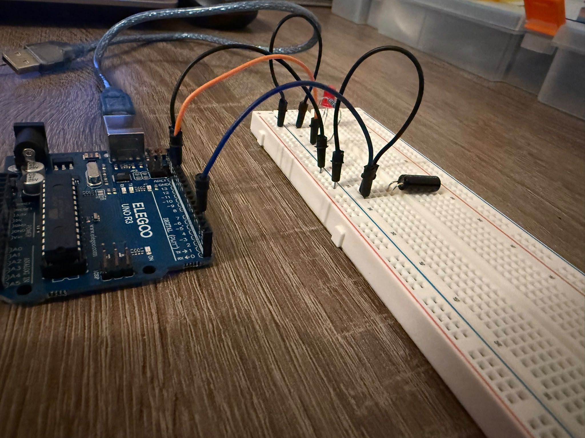

# 07 – Kippkugelschalter

## Ziel
Mit dem Kippkugelschalter eine Neigung erkennen. Mein Ziel ist es,
die Neigung mit einer LED anzuzeigen.

## Bauteile
- ELEGOO UNO R3
- ein Steckbrett
- Jumper-Kabel
- ein Widerstand (220 Ω)
- eine rote LED
- ein Kippkugelschalter (SW520D)

## Schaltung
Zuerst stecke ich die LED in das Steckbrett. Die LED braucht einen
Vorwiderstand. Deshalb stecke ich einen 220-Ω-Widerstand in dieselbe Reihe
wie das lange Bein. Danach verbinde ich den Widerstand mit Pin 12.
Zum Schluss verbinde ich das kurze Bein der LED über das schwarze Kabel
mit der Minusschiene.

Danach kommt der Kippkugelschalter. Zuerst stecke ich ihn in das Steckbrett.
Dann verbinde ich ein Bein mit Pin 2. Die Schaltung braucht auch eine
Verbindung zur Masse. Deshalb verbinde ich das andere Bein mit dem GND-Pin.

## Funktion
Im Code habe ich Pin 2 als Eingang mit internem Pull-up-Widerstand
eingestellt (`INPUT_PULLUP`). Der Arduino prüft, ob an Pin 2 HIGH oder LOW
anliegt. Wenn der Sensor senkrecht steht, verbindet die Kugel Pin 2 mit GND
(LOW), und die LED leuchtet nicht. Wenn der Sensor geneigt ist, ist die
Verbindung unterbrochen (HIGH), und die LED leuchtet.

## Code
💾 [Arduino-Code](07_kippkugelschalter.ino)

## Beobachtung
Bei diesem Versuch habe ich Folgendes beobachtet: Wenn der Sensor senkrecht
steht, leuchtet die LED nicht. Wenn der Sensor geneigt ist, leuchtet die LED.
Wenn ich den Sensor schüttle, flackert außerdem die LED, weil die Kugel beim
Schütteln prellt. Dadurch wird der Stromkreis immer wieder geöffnet und
geschlossen.

Wenn ich den Sensor herausnehme, leuchtet die LED dauerhaft, weil der
Stromkreis dann dauerhaft geöffnet ist. Deshalb erkennt der Arduino,
dass an Pin 2 HIGH anliegt. So meldet die Schaltung auch einen Drahtbruch.

## Problem & Lösung
Beim Programmieren sind mir mehrere Fehler passiert:

1. **Eingang und Ausgang verwechselt:** Ich habe dem Sensor mit
   `pinMode(Neigung, OUTPUT)` die Aufgabe eines Ausgangs gegeben. Der Sensor
   ist aber ein Eingang, weil der Arduino ihn abfragt. Deshalb habe ich
   `INPUT_PULLUP` verwendet.
2. **Befehle verwechselt:** Ich habe `pinMode` auch im `loop()` benutzt, um die
   LED zu schalten. Dann habe ich gelernt: `pinMode` gibt dem Pin nur einmal im
   `setup()` eine Aufgabe. `digitalRead` fragt einen Eingang ab, und
   `digitalWrite` schaltet einen Ausgang.
3. **Klammer an der falschen Stelle:** Ich hatte `digitalRead(Neigung == HIGH)`
   geschrieben. Richtig ist `digitalRead(Neigung) == HIGH`: Zuerst wird der Pin
   gelesen, dann wird das Ergebnis verglichen.
4. **Groß- und Kleinschreibung:** `digitalread` funktioniert nicht, richtig ist
   `digitalRead`. C++ unterscheidet zwischen Groß- und Kleinschreibung.

**Hinweis zur ELEGOO-Anleitung:** Im Beispielcode steht `pinMode(2, INPUT)`.
Ohne Pull-up-Widerstand ist der Eingang aber undefiniert, wenn die Kugel den
Kontakt öffnet. Mit `INPUT_PULLUP` funktioniert die Schaltung zuverlässig.

## Erkenntnis
Die Logik ist einfach: Wenn der Pin mit GND verbunden ist, erkennt der Arduino
diese Verbindung als LOW, und die LED leuchtet nicht. Wenn der Pin nicht mit
GND verbunden ist, zieht der interne Pull-up-Widerstand den Pin auf HIGH,
und die LED leuchtet.

