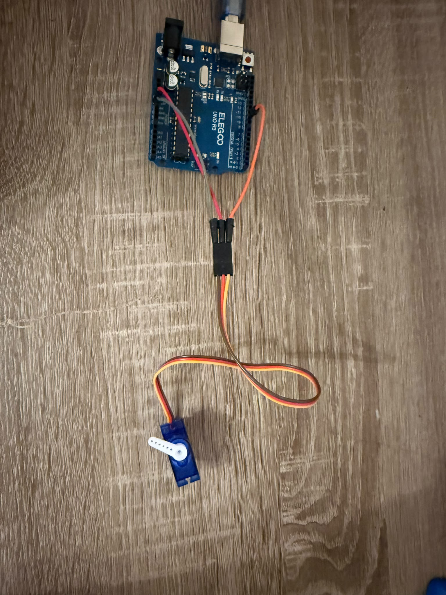

# 08 – Servomotor

## Ziel
Mit dem Servomotor einen Winkel einstellen. Mein Ziel ist es, einen
Servomotor mit dem Arduino zu steuern und den Arm des Servomotors auf
einen bestimmten Winkel zu drehen.

## Bauteile
- ELEGOO UNO R3
- ein Servomotor (SG90) mit Servohorn
- ein Steckbrett
- einige Jumper-Kabel

## Schaltung
Die Schaltung des Servomotors ist eigentlich sehr einfach: Der Servomotor hat
drei eigene Kabel – ein braunes, ein rotes und ein orangefarbenes. Die Kabel
enden in einem Stecker. In diesen Stecker stecke ich Jumper-Kabel. Zuerst
verbinde ich das rote Kabel mit dem 5-V-Pin, dann verbinde ich das braune
Kabel mit dem GND-Pin, und danach verbinde ich das orangefarbene Kabel
(Signal) mit Pin 9. Zum Schluss stecke ich den Arm des Servomotors auf.

## Funktionsprinzip
Der Servo bekommt alle 20 ms einen Impuls (f = 50 Hz).
Die Impulsdauer bestimmt den Winkel:

| Winkel | Impulsdauer t_i | Tastgrad g |
|--------|-----------------|------------|
| 0°     | 1 ms            | 0,05       |
| 90°    | 1,5 ms          | 0,075      |
| 180°   | 2 ms            | 0,1        |

Bei der LED war die Information im Mittelwert der Spannung.
Beim Servo steckt die Information direkt in der Impulsdauer.
Die Servo-Bibliothek erzeugt diese Impulse automatisch.

## Code
💾 [Arduino-Code](08_servo.ino)

Mit einer `for`-Schleife dreht sich der Servo Grad für Grad.
Nach jedem Schritt wartet das Programm 10 ms.

## Beobachtung
**Versuch 1 – Geschwindigkeit:** Laut Datenblatt braucht der Servo für 60°
etwa 0,12 s. Für 180° braucht er also etwa 0,36 s. Mit `delay(200)` hat er
zu wenig Zeit: Er erreicht nur etwa 100° und dreht dann schon wieder zurück.
Er bewegt sich wie ein Scheibenwischer.

**Versuch 2 – langsame Bewegung:** Mit der `for`-Schleife bewegt sich der Servo
gleichmäßig. Mit `delay(15)` dauert eine Richtung 180 × 15 ms = 2,7 s.
Das war mir zu langsam. Mit `delay(10)` dauert sie nur 1,8 s.

## Problem & Lösung
- **Der Arm war schief montiert:** Ich habe den Servo im Code auf 90° gestellt,
  den Arm vorsichtig abgezogen und senkrecht wieder aufgesteckt.
- **`delay(1000)` in der Schleife:** Ich dachte, `delay` ist die Zeit für die
  ganze Bewegung. Aber `delay` steht in der Schleife und wirkt bei jedem Grad.
  Eine Richtung hätte 3 Minuten gedauert. Deshalb habe ich `delay(10)` verwendet.
- **`meinServo.write(i) += 1;`:** Die Variable `i` wird schon im Kopf der
  `for`-Schleife erhöht. Richtig ist nur `meinServo.write(i);`.
- **Negative Winkel:** Für die Rückwärtsbewegung hatte ich bei −180 begonnen.
  Ein Servo kennt nur 0° bis 180°. Richtig ist: bei 180 beginnen und `i -= 1`.

## Erkenntnis
- Ein Servo bekommt seine Position über die Impulsdauer, nicht über den Mittelwert.
- `delay` in einer Schleife wirkt bei jedem Durchlauf.
- Der Servo braucht etwa 2 ms pro Grad. Wenn die Wartezeit kürzer ist,
  erreicht er seine Position nicht.

  📄 [Aufgabenblatt mit Berechnungen und Diagrammen (PDF)](08_Servo.pdf)

